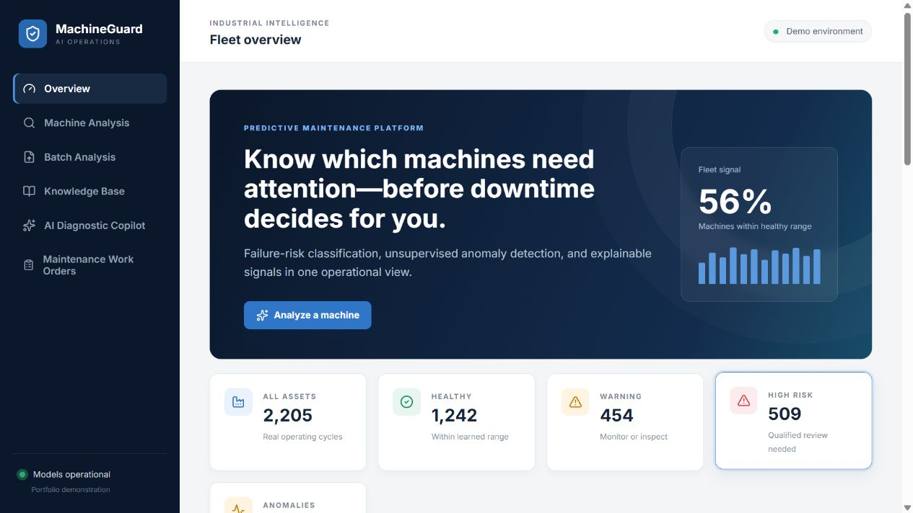
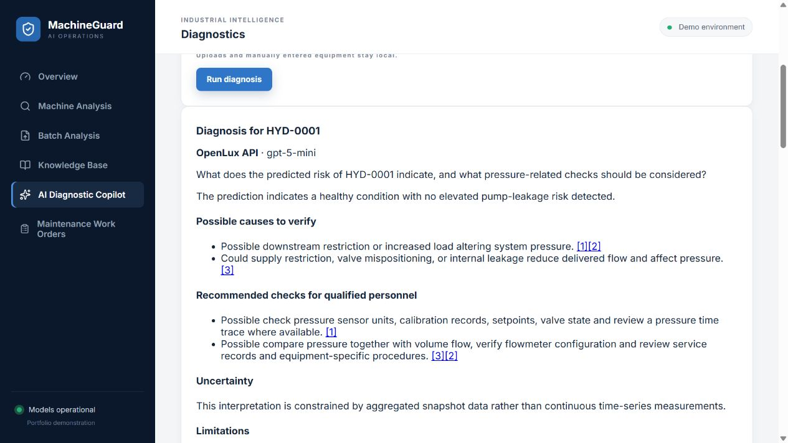
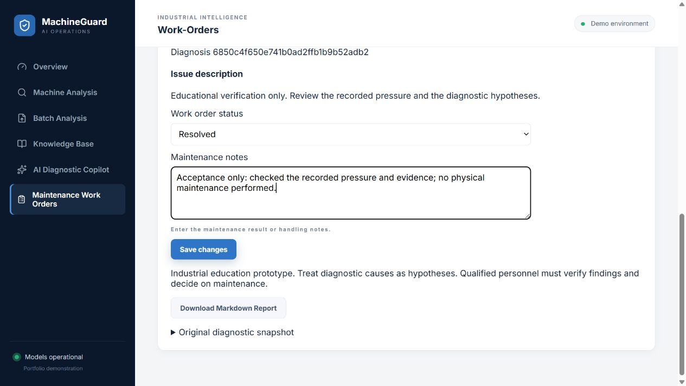
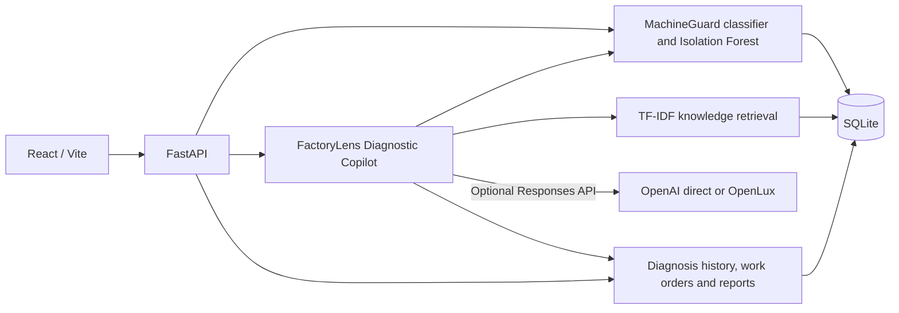

# FactoryLens

**From a hydraulic sensor reading to a documented maintenance decision.**
FactoryLens extends MachineGuard AI with an evidence-backed diagnostic
copilot, human-reviewed work orders, and reproducible Markdown reports.
It runs locally without a cloud key and can optionally use an OpenAI-compatible
provider for structured diagnostic assistance.



Maintenance teams need a way to connect a risk signal to the measurements,
references, and follow-up decisions behind it. FactoryLens demonstrates that
workflow on recorded hydraulic test-rig cycles. It is an educational engineering
prototype. Qualified personnel must verify hypotheses and decide whether to
inspect or service equipment.

## What you can do

1. Look up `HYD-0001`, inspect five measured signals, or score a CSV batch.
2. Search bundled or uploaded maintenance references with TF-IDF and read the
   exact excerpts.
3. Ask the copilot a question. Review the original sensor and ML snapshot,
   hypotheses, tool calls and citations. Retrieval-only mode displays local
   evidence when cloud generation is disabled or unavailable.
4. Confirm a work order, record maintenance notes, and move it through
   **Open → In Progress → Resolved**.
5. Download a diagnosis or work order as a UTF-8 Markdown report.

[All seven real application captures](docs/images/README.md)

<table>
  <tr>
    <td></td>
    <td></td>
  </tr>
</table>

## Architecture and contribution



[System, Agent and maintenance workflow diagrams](docs/architecture.md)

| MachineGuard AI upstream | FactoryLens additions |
| --- | --- |
| Dashboard, hydraulic dataset preparation, classifier, Isolation Forest, model metadata, and batch scoring | TXT/Markdown knowledge library, chunking, duplicate detection, TF-IDF and citations |
| React/Vite and FastAPI foundation with SQLite asset storage | Responses API tool calling, strict diagnosis checks, per-stage request and token budgets, offline fallback, and saved evidence snapshots |
| Model evaluation, training scripts, and deployment scaffolding | Human-confirmed work orders, Markdown export, retrieval and snapshot evaluation, QA and portfolio documentation |

**Stack** Python, FastAPI, Pydantic, SQLite, scikit-learn, React, TypeScript,
Vite, OpenAI Python SDK, pytest, Vitest, Ruff, ESLint and GitHub Actions.

## Run locally

Use Python 3.12, a current Node.js 22 LTS release and pnpm 11. Python 3.11 or
newer is declared in package metadata. Local Windows acceptance used Python
3.12.14, Node.js 24.22.3 and pnpm 11.25.0. Start in the repository root:

```powershell
python -m venv .venv
.\.venv\Scripts\python.exe -m pip install -e ".[dev]"
.\.venv\Scripts\python.exe -m uvicorn backend.app.main:app --host 127.0.0.1 --port 8123
```

If Python is unavailable on the PowerShell PATH, use the full path to the
installed interpreter on the first line. In a second terminal:

```powershell
cd frontend
pnpm install --frozen-lockfile
pnpm dev --host 127.0.0.1 --port 5174
```

Open [the dashboard](http://127.0.0.1:5174/) and [the API docs](http://127.0.0.1:8123/docs).
The Vite proxy forwards API requests to port 8123. Bundled model files and
processed data support the local demo. First startup initializes SQLite and
imports three educational references. To serve the built frontend from
FastAPI, run `pnpm build` under `frontend` and restart FastAPI.

### Environment and offline use

Cloud is optional. Open Copilot with cloud generation unchecked to run
retrieval-only diagnosis. Missing credentials, provider errors, incomplete
responses, or failed validation also return local evidence when available.
For cloud use, copy [`.env.example`](.env.example) to a local `.env`, fill only
the selected provider's key, and restart the backend:

| Variable | Purpose |
| --- | --- |
| `LLM_PROVIDER` | `openai` for direct access or `openlux` for the OpenLux relay |
| `OPENAI_API_KEY` / `OPENLUX_API_KEY` | Backend-only credential for the corresponding provider |
| `OPENAI_BASE_URL` | Leave blank for the provider's default trusted URL |
| `OPENAI_MODEL` | Enabled model ID, e.g. `gpt-5-mini` for the verified OpenLux run |
| `LLM_TOOL_MAX_OUTPUT_TOKENS` / `LLM_FINAL_MAX_OUTPUT_TOKENS` | Default output budgets of 1,200 and 4,000 |
| `DATABASE_PATH` | SQLite path. Use a separate path for experiments and acceptance tests |

Cloud requests carry public UCI readings and verified bundled excerpts after
opt-in. Keep credentials in the backend environment. See the
[configuration and privacy guide](docs/diagnostic-copilot.md).

## APIs and project layout

| Group | Main routes under `/api/v1` |
| --- | --- |
| MachineGuard scoring | `/assets/summary`, `/machines/{id}`, `/predict`, `/predict/batch` |
| Knowledge | `/knowledge/documents`, `/knowledge/search` |
| Diagnosis | `/diagnostics`, `/diagnostics/{id}`, `/diagnostics/{id}/report` |
| Work orders | `/work-orders`, `/work-orders/{id}`, `/work-orders/{id}/report` |

```text
backend/app/       FastAPI routes, tools, retrieval, persistence, reports
backend/tests/     API, integration and mocked provider coverage
frontend/src/      React pages, client and interaction tests
ml/                Upstream feature engineering and bundled models
data/              Dataset attribution, processed cycles and sample CSV
scripts/           Training utilities and offline evaluation
docs/              Architecture, guides, real screenshots, acceptance
```

## Verified results

| Check | Observed result |
| --- | --- |
| Local automated checks | **54 pytest and 16 Vitest tests passed**, a net increase of 55 over the baseline. Ruff, ESLint and production build passed. |
| Reproducibility | Clean Windows environment installed and started. Fresh SQLite initialization and restart persistence passed. |
| Real cloud acceptance | One OpenLux `gpt-5-mini` diagnosis used two completed Responses calls. Model tool calls executed and structured output, citations, and saved history were verified. The two requests took 25.863 s and used 5,619 total tokens. |
| Small retrieval development set | **7/8** cases. Six positive cases gave Hit@3 **6/6**, MRR@3 **1.00**. One of two expected-empty queries succeeded. |

The unsupported manufacturer torque question still retrieved general
hydraulics excerpts. The retrieval set has no independent split. In a
[project-owner review with ChatGPT assistance](docs/groundedness-review.md),
2/4 findings were supported, 2/4 partially supported, and 0/4 unsupported.
Both hypotheses need clearer operating-condition prerequisites. The review
supports educational demonstration of this case. Industrial validity remains unverified. Cloud
verification describes one archived run. GitHub Actions is configured and has
yet to run on the intended release repository. [Final system acceptance](docs/final-acceptance.md)
and [evaluation details](docs/maintenance-evaluation.md)

```powershell
.\.venv\Scripts\python.exe -m pytest
.\.venv\Scripts\python.exe -m ruff check backend ml scripts
.\.venv\Scripts\python.exe -m scripts.evaluate_maintenance
cd frontend
pnpm lint
pnpm test
pnpm build
```

## Limits and next steps

The dataset contains rig cycles, with each `HYD-####` identifying a recorded
cycle. It does not represent a monitored factory fleet. TF-IDF relies on
word overlap, and the current citation validator checks reference
consistency. Practical next steps include human evaluation of each claim,
independent retrieval cases with more unsupported in-domain queries,
and authorization and site validation before shared use.

## Attribution and license

Upstream dashboard, models and training pipeline come from
[MachineGuard AI by sneha2003](https://github.com/sneha2003/machineguard-ai).
The original notices are preserved in [LICENSE](LICENSE) under MIT.

The real measurements come from Helwig, Pignanelli and Schütze,
*Condition Monitoring of Hydraulic Systems*, [UCI Machine Learning Repository, DOI 10.24432/C5CW21](https://doi.org/10.24432/C5CW21),
under [CC BY 4.0](https://creativecommons.org/licenses/by/4.0/).
The included table aggregates test-rig signals by cycle.
See [dataset and preprocessing details](data/README.md). The maintenance
example documents and QA notes are educational material created for FactoryLens.
