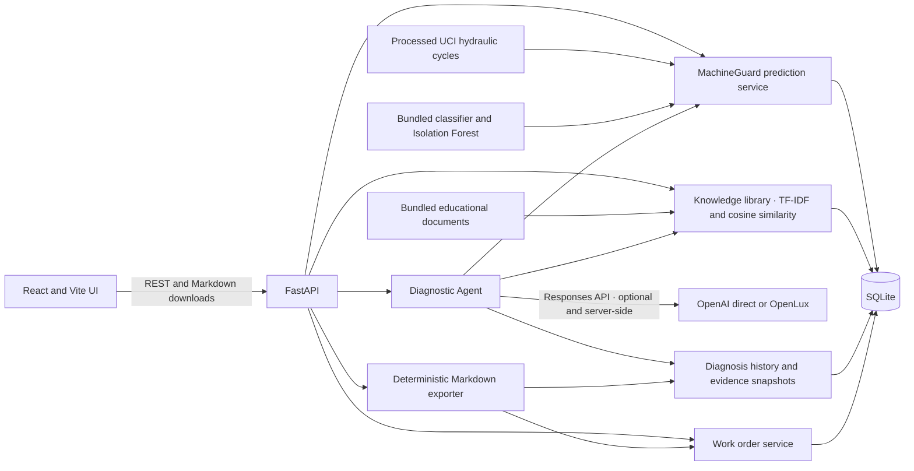
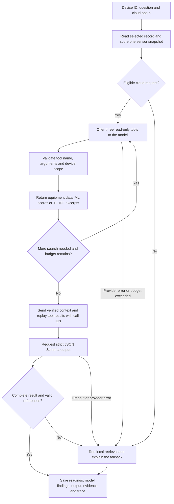
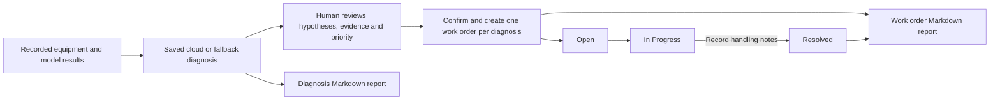

# FactoryLens architecture

FactoryLens adds evidence retrieval, diagnosis and maintenance workflow to the
MachineGuard AI dashboard and predictive models. The API starts the services
against a single SQLite database per environment.

## System

The cloud path is opt-in and restricted to public UCI equipment records and
verified bundled excerpts. Private uploads and manually entered equipment can
be used in the local retrieval-only workflow.

## Tool calling and RAG

The backend fills numeric findings and keeps source attribution. Execution
trace rows record backend or model-originated tool calls. Limits, citation
validation and evidence snapshot behavior are detailed in the
[Diagnostic Copilot guide](diagnostic-copilot.md).

## Maintenance workflow

Work orders use an immutable diagnosis snapshot and maintain current status
and notes. The report endpoints format saved local data without an API call.
